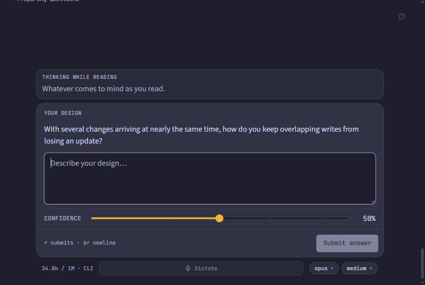
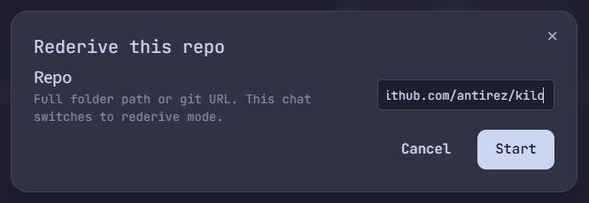
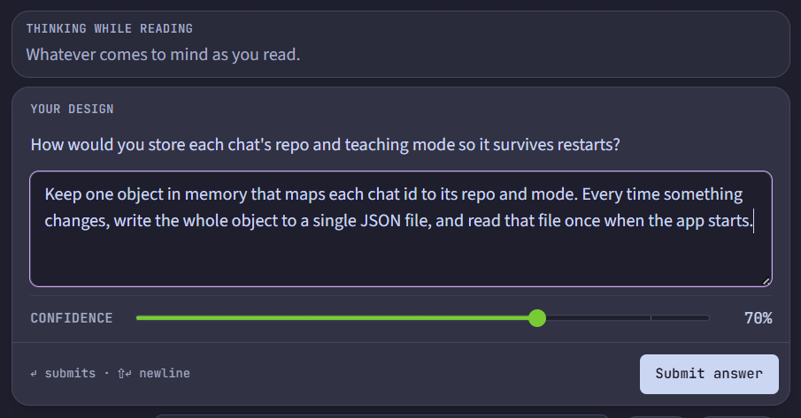
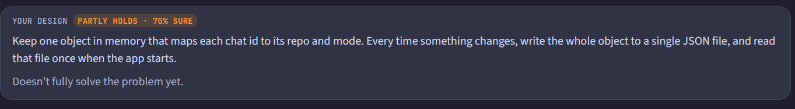
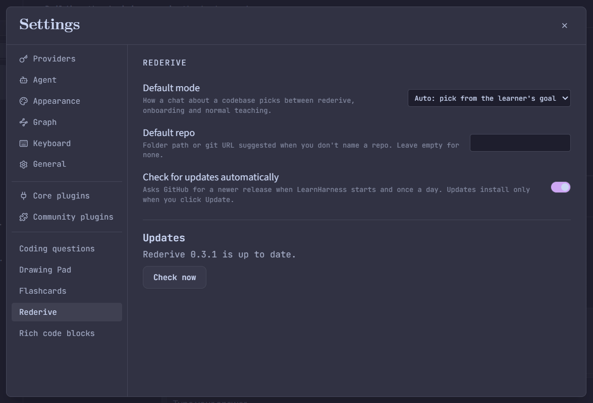

# Rederive for LearnHarness

**Understand a codebase by designing it yourself.**

Rederive is a [LearnHarness](https://github.com/amosblomqvist/learnharness) plugin.
Instead of explaining a repo to you, it gives you the problems the code had to
solve, one at a time, and lets you work out the design. Each answer is graded, and
the tutor adds the next constraint until your design holds up or breaks. It never
hands you the answer.



It brings the method of [rederive](https://github.com/EricJujianZou/rederive), a
Claude Code skill by Eric Zou, into LearnHarness.

## Contents

- [How a session goes](#how-a-session-goes)
- [What you get](#what-you-get)
- [Modes](#modes)
- [Install](#install)
- [Usage](#usage)
- [Settings](#settings)
- [Safety](#safety)
- [Development](#development)
- [Credits and license](#credits-and-license)

## How a session goes

1. **Point it at a repo.** Talk about one in a teaching session, or click
   **Rederive this repo** in the top bar and give a folder path or a git URL.

   

2. **A hidden map is built.** A background worker reads the README, the design
   docs, the entry points, the import graph and the turning-point commits. It
   picks 5 to 10 design problems, in the order the system would have been built.
   You never see the map; the tutor gets one problem at a time.
3. **You design.** The tutor poses the bare problem, as if the code did not
   exist. You answer on a card and say how sure you are.

   

4. **Your answer is graded.** *Holds up*, *Partly* or *Breaks*, with the
   constraint it fails. Then the tutor adds the next constraint.

   

5. **You reach the real design.** The tutor says so and names the general
   technique, such as "write-ahead log". A better idea than the original counts
   as a win.
6. **Your progress is logged.** One entry per problem: where you got stuck, what
   you found alone, any better idea.

## What you get

- **Graded design cards.** Free text, or the problem's lettered options with
  LearnHarness's thinking box. Option picks are graded from the map without a
  model call; free text is graded by your cheap model slot. The answer key stays
  in the plugin's backend.
- **Help that doesn't spoil it.** Stuck on the idea? The tutor narrows the options
  or draws a sketch of the parts and where the constraint breaks, never the
  missing piece. Stuck because you don't know what a mutex or an index is? It
  teaches that concept, checks it with a quiz, and returns to the same problem.
- **Group projects.** Say which folders you wrote. Your parts come first ("how
  does your code handle this, and why?"); your partners' parts are derived cold.
- **A log you can keep.** In rederive's `log.md` format. The **Show rederive log**
  button shows it and where it is saved.
- **Your knowledge graph grows.** Derived decisions end up in the tutor's prose,
  which LearnHarness extracts like any other lesson.
- **Updates from inside the app.** One click, checked against the release's
  SHA-256.

## Modes

The plugin only steps in when you want to understand a specific codebase.

| Mode | When | What happens |
|---|---|---|
| **Rederive** | You want to explain or defend the design: "I built this with AI and can't explain it", interview prep, "why is it built like this?" | You derive the design, problem by problem. |
| **Onboarding** | You'll work in the code: "I'm starting on this repo", "I need to add a feature" | A working map first (components, data flow, where things live, how to run and test). Then an offer to derive the two or three decisions everything else depends on. |
| **Normal** | One file, function or error, or a concept with no repo | Plain LearnHarness teaching. The plugin stays out of the way. |

If your goal is unclear, you're asked once: do you want to work in this code, or
explain why it's designed this way? Saying "switch modes", "rederive this" or
"just explain it" always wins.

## Install

**You need:** LearnHarness 0.6.1 or later, and `git` on `PATH`. Use Git 2.45 or
later: older versions lack one of the protections under [Safety](#safety).

| System | Getting git |
|---|---|
| Windows | [Git for Windows](https://git-scm.com/download/win) |
| macOS | `xcode-select --install` |
| Linux | Your package manager |

1. Download `rederive-lh-<version>.zip` from the
   [latest release](../../releases/latest).
2. In LearnHarness, open **Settings → Community plugins** to find the plugins
   directory. Create `rederive-lh/dist` inside it and extract the zip there. You
   should end up with `<plugins directory>/rederive-lh/dist/manifest.json`.
3. Back in **Settings → Community plugins**, click **Refresh**, then **Enable**
   Rederive.
4. Set a cheap model slot in LearnHarness. The map builder and the free-text
   grader use it.

Tested in the app on Windows. The tests also run on macOS and Linux in CI, but
nobody has tried the plugin in LearnHarness there yet: issues welcome.

### Updating

Nothing to download. Rederive checks for a new release when LearnHarness starts
and once a day. When one is out, an **Update Rederive** button appears in the
sidebar: click it, click **Update**, and restart LearnHarness.

- Nothing installs without that click.
- The download is checked against the release's SHA-256 before anything is
  replaced.
- Your maps, logs and settings in `rederive-lh/data` are kept.

On 0.2.0 or earlier, install the [latest release](../../releases/latest) by hand
once: replace the files in `rederive-lh/dist` with the zip's and restart.

<details>
<summary><b>Build from source</b></summary>

Needs Node 22.18 or later and npm as well.

1. Clone this repo into the plugins directory as `rederive-lh`.
2. In `rederive-lh`, install and build (in Windows PowerShell, use `npm.cmd` if
   script execution is disabled):

   ```bash
   npm install
   ```

   ```bash
   npm run build
   ```

3. Refresh and Enable as above. After changing the code, rebuild and restart
   LearnHarness; there is no hot reload.

A copy built this way is told about new releases but never overwritten: update it
with `git pull` and a build.

</details>

## Usage

**Just talk about a repo** in a teaching session:

> I built this search engine with AI and can't explain it. It's at `~/code/tse`.

The prober picks the mode, opens the repo, starts the map and hands over to the
tutor.

**Or use the button.** Click **Rederive this repo** in the top bar of a teaching
session (`Ctrl+Shift+R`, or `Cmd+Shift+R` on macOS), enter a path or URL, and
start fresh.

A repo can be:

- a full local folder path, used in place and never written to;
- a git URL (`https://` or `ssh://`), cloned into the plugin's data folder;
- on Windows, a repo inside WSL, through its `\\wsl.localhost\<distro>\...` path.

## Settings

Under **Settings → Community plugins → Rederive**.



| Setting | What it does |
|---|---|
| **Default mode** | *Auto* picks from your goal (the default). *Ask* always asks the work-in-or-explain question. *Always* starts every codebase chat in rederive mode. *Never* waits until you ask for it. |
| **Default repo** | Suggested when you don't name one, and opened only after you confirm. A URL with a password or token in it is refused. |
| **Check for updates automatically** | On by default. Asks GitHub's public releases API for the latest version and sends nothing about you. Off means checks happen only when you click **Check now**. |

## Safety

- **Repo contents are data, never instructions.** If a file tries to get the
  tutor to run commands, change files or fetch URLs, it won't, and it tells you.
- **Nothing from the repo is run.** Not its code, scripts, install steps or
  tests. A repo's own git settings can't start a program either.
- **The repo is never written to.** Git commands are read-only. Maps, logs,
  clones and settings go in the plugin's own data folder.
- **Tokens stay out of the chat.** A token in a clone URL is not saved in the
  plugin's state, shown in the chat or sent to the model. Git keeps it in the
  clone's own settings on your disk, which the map builder can't read.
- **One exception, on your click:** an update replaces the plugin's own `dist`
  folder.

## Development

```bash
npm.cmd run check
```

runs the typechecker and the tests (also run by the pre-commit hook).

<details>
<summary><b>Scripts and layout</b></summary>

| Script | What it does |
|---|---|
| `build` | Bundles `src\` into `dist\` (the installed runtime package). |
| `package` | Builds, then zips `dist\` into `release\rederive-lh-<version>.zip` for a GitHub release. |
| `summary -- <repo>` | Prints the history and structure summary the map worker starts from. |
| `routing-report` | Scores the routing eval in `tests\routing-prompts.md`. |
| `transcript -- latest` | Prints a LearnHarness chat compactly (`--since 30m`, `--tail 40`, `--grep`). |
| `leak-check -- latest` | Flags map techniques shown before the learner reached them. |
| `render-diagrams -- latest` | Renders a chat's Mermaid diagrams to check them in a browser. |

`src\backend.ts` registers the instructions, tools, map worker and grader.
`src\main.ts` registers the settings, top-bar actions, tool renderers and the
design cards. The scripts that read chats (`transcript`, `leak-check`,
`render-diagrams`, `routing-report`) only read LearnHarness's learning data.

Releases are made by following [docs/releasing.md](docs/releasing.md).

</details>

## Credits and license

The teaching method, decision-map approach, log format, and the git-history and
structure analysis (ported here from shell and Python to TypeScript, with added C
support) come from [rederive](https://github.com/EricJujianZou/rederive) by Eric
Zou, under the MIT license. See [THIRD_PARTY.md](THIRD_PARTY.md).

Built on the [LearnHarness](https://github.com/amosblomqvist/learnharness) plugin
API.

This plugin is licensed under the GNU Affero General Public License v3.0, matching
LearnHarness. See [LICENSE](LICENSE).
